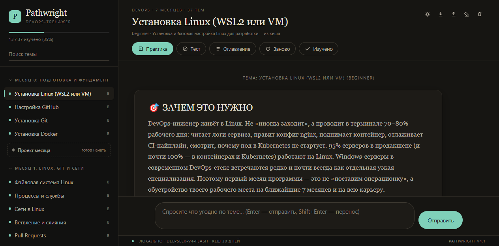
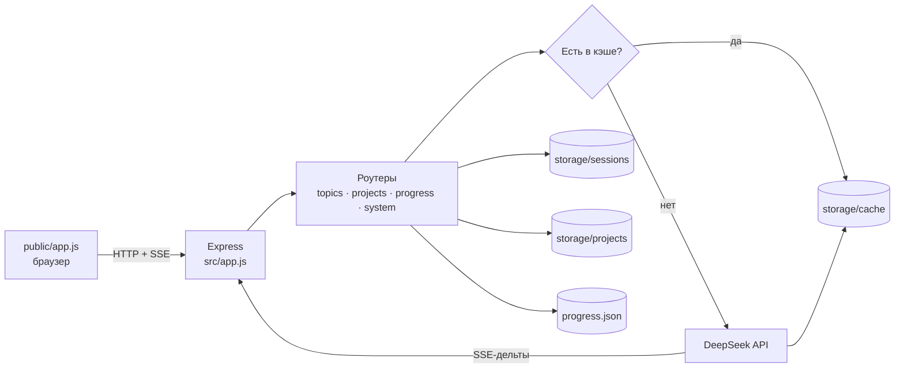

# Pathwright

**Локальный тренажёр по DevOps с ИИ-наставником.** Роадмап на 7 месяцев, полноценные уроки, практические воркшопы, тесты и итоговые проекты — всё под ваш уровень и с сохранением прогресса на диске.

[](https://nodejs.org)
[](LICENSE)
[](https://github.com/Qatrol/pathwright/actions/workflows/ci.yml)


---

## Что это

Учить DevOps по разрозненным статьям тяжело: непонятно, что учить следующим, как проверить, что понял, и где остановился. Pathwright даёт структуру: 37 тем от установки Linux до подготовки к собеседованию. На каждую тему наставник пишет большой урок, даёт практическое задание и проводит тест.

Всё работает локально: Node.js-сервер, одностраничный интерфейс, JSON-файлы вместо базы данных. Наружу уходят только запросы к DeepSeek API.

## Возможности

- **Роадмап на 7 месяцев** — 37 тем по порядку, прогресс в процентах, поиск и сворачиваемые месяцы
- **Три режима на тему** — урок, практический воркшоп, тест с вопросами с собеседований
- **ИИ-наставник с контекстом** — помнит историю диалога по теме, знает, что вы уже прошли, и объясняет с нужного уровня
- **Проект месяца** — итоговая практика по изученным темам, шаг за шагом, без готовых решений
- **Стриминг** — текст появляется по мере генерации; если модель обрезалась по лимиту, сервер дописывает ответ
- **Кэш на 30 дней** — повторный просмотр урока не тратит токены
- **Сессии на 90 дней** — можно вернуться к любой теме и продолжить диалог
- **Экспорт и импорт** — прогресс и проекты в JSON, урок и проект в Markdown
- **Светлая и тёмная тема**, адаптивная вёрстка, горячие клавиши

## Скриншоты

| Светлая тема | Тёмная тема |
|---|---|
|  |  |

## Быстрый старт

Нужен Node.js 18+ и ключ [DeepSeek API](https://platform.deepseek.com/api_keys).

```bash
git clone https://github.com/Qatrol/pathwright.git
cd pathwright
npm install
cp .env.example .env
# откройте .env и вставьте DEEPSEEK_API_KEY
npm start
```

Откройте [http://localhost:5555](http://localhost:5555).

На Windows можно запустить `start.bat` — он проверит Node.js, `.env`, зависимости и откроет браузер.

### Docker

```bash
cp .env.example .env   # вставьте ключ
docker compose up -d --build
```

Приложение будет на `http://localhost:5555`, данные — в `./storage` на хосте. В контейнере `HOST=0.0.0.0`, снаружи порт публикуется только через compose.

### Переменные окружения

| Переменная | Обязательна | По умолчанию | Описание |
|---|---|---|---|
| `DEEPSEEK_API_KEY` | да | — | ключ DeepSeek |
| `PORT` | нет | `5555` | порт сервера |
| `HOST` | нет | `127.0.0.1` | интерфейс; `0.0.0.0` — для Docker или доступа из сети |
| `STORAGE_DIR` | нет | `./storage` | каталог данных (кэш, сессии, проекты, логи) |
| `DEEPSEEK_MODEL` | нет | `deepseek-v4-flash` | модель |
| `STUDENT_PROFILE` | нет | профиль автора | описание уровня ученика, влияет на стиль объяснений |

## Как это работает



1. Браузер запрашивает роадмап, прогресс и последнюю открытую тему.
2. При открытии темы сервер проверяет кэш. Если ответ есть и моложе 30 дней — отдаёт его сразу и бесплатно.
3. Иначе собирается промпт: роль наставника, профиль ученика, вся программа, текущий прогресс, тема и тип запроса. Запрос уходит в DeepSeek со стримингом.
4. Дельты летят в браузер через SSE и сразу рендерятся. Ответ сохраняется в кэш и в сессию, прогресс обновляется.
5. Если модель остановилась по лимиту токенов, сервер автоматически просит продолжение (до двух раз).

## Структура проекта

```
pathwright/
├─ server.js                 # точка входа: listen, очистка, graceful shutdown
├─ src/
│  ├─ app.js                 # Express: статика public/ и монтирование роутеров
│  ├─ config.js              # конфиг из .env, константы, пути storage
│  ├─ roadmap.js             # программа: 7 месяцев, 37 тем
│  ├─ progress.js            # прогресс по темам и контекст месяца
│  ├─ prompts.js             # роли наставника и промпты (урок/практика/тест/проект)
│  ├─ llm.js                 # DeepSeek: стриминг, ретраи, автопродолжение, лог токенов
│  ├─ lib/                   # fs-json, id-валидация, in-flight, обрезка истории, async-wrapper
│  ├─ storage/               # кэш, сессии, проекты + TTL-очистка
│  └─ routes/                # system, progress, topics, projects
├─ public/
│  ├─ index.html             # разметка
│  ├─ styles.css             # редакционная тема, светлая и тёмная
│  ├─ app.js                 # роадмап, SSE, markdown, прогресс, проекты
│  └─ favicon.svg
├─ tests/app.test.js         # node:test — API и утилиты, без вызовов DeepSeek
├─ scripts/check.js          # синтаксическая проверка всех JS-файлов
├─ docs/                     # скриншоты и архитектура
├─ Dockerfile · docker-compose.yml · .dockerignore
├─ .github/workflows/ci.yml  # syntax check + tests + smoke test
└─ storage/                  # создаётся автоматически, в .gitignore
   ├─ cache/                 # ответы модели (TTL 30 дней)
   ├─ sessions/              # история диалогов (TTL 90 дней)
   ├─ projects/              # планы и шаги проектов
   ├─ logs/                  # расход токенов по дням
   └─ progress.json
```

## API

| Метод | Путь | Назначение |
|---|---|---|
| `GET` | `/health` | статус, версия, размеры кэшей |
| `GET` | `/api/roadmap` | программа курса |
| `GET` | `/api/stats` | прогресс, процент, кэш, оценка токенов |
| `GET/POST` | `/api/progress` | чтение и слияние прогресса |
| `GET` | `/api/cache/:topicId/:type` | проверка кэша |
| `GET` | `/api/history/:sessionId` | текущая тема и число тем в сессии |
| `POST` | `/api/explain` | урок по теме (SSE) |
| `POST` | `/api/task` | практический воркшоп (SSE) |
| `POST` | `/api/quiz` | тест (SSE) |
| `POST` | `/api/ask` | вопрос по текущей теме (SSE) |
| `POST` | `/api/reset-topic` | сбросить историю темы |
| `POST` | `/api/delete-topic` | удалить тему из кэша и сессии |
| `GET` | `/api/project/:monthId` | состояние проекта месяца |
| `POST` | `/api/project/start` | сгенерировать план проекта (SSE) |
| `POST` | `/api/project/ask` | шаг проекта (SSE) |
| `POST` | `/api/project/reset` | сбросить проект |
| `GET` | `/api/project/:monthId/export` | проект в Markdown |
| `POST` | `/api/project/import` | импорт проектов |
| `GET` | `/api/export` | полный бэкап JSON |
| `GET` | `/api/tokens-report` | расход и оценка стоимости токенов |

SSE-события: `delta` (текст), `cached` (ответ из кэша), `continuation` (номер автопродолжения), `usage` (токены), `warning` (ответ обрезан), `done`, `error`.

## Как устроен ИИ

- **Промпт из слоёв.** Системная защита от подмены роли → роль наставника и профиль ученика → вся программа → текущий прогресс → тема и задача. Модель видит, что ученик уже прошёл, и не объясняет Kubernetes человеку, который ещё не поставил Docker.
- **Стриминг + автопродолжение.** Ответ идёт через SSE. Если `finish_reason = length`, сервер добавляет последний фрагмент и просит продолжить — до двух раз. Если и после этого обрезано, в браузер уходит предупреждение.
- **Кэш по теме и типу.** Ключ — `topicId + тип + версия кэша`. Версия (`v4`) позволяет разом инвалидировать старые ответы при смене промптов. TTL — 30 дней, старые файлы чистит фоновый таймер.
- **Дедупликация.** Пока один и тот же урок генерируется, повторный запрос ждёт тот же промис, а не запускает второй вызов.
- **Ретраи.** Сетевые ошибки, `429` и `5xx` повторяются до трёх раз с паузой; `400/401/403` не повторяются. Повтор возможен только до отправки первого байта клиенту.
- **Heartbeat.** Комментарий `: ping` каждые 15 секунд не даёт прокси прибить соединение, пока модель думает.
- **Лимит запросов.** Не больше 20 платных генераций в минуту с одного адреса — защита от случайного цикла и чужого скрипта.
- **Экономия контекста.** История вопроса обрезается по 50 сообщениям и 24 000 символов, история проекта — по 48 000.
- **Лог токенов.** Каждый вызов пишет день, эндпоинт, prompt/completion и попадания в кэш DeepSeek в `storage/logs/tokens-YYYY-MM-DD.log`; `/api/tokens-report` считает оценку стоимости.

Подробности — в [docs/ARCHITECTURE.md](docs/ARCHITECTURE.md).

## Безопасность

- Ключ API живёт только в `.env`, который исключён из git.
- `storage/` тоже в `.gitignore`: там личные диалоги, проекты и прогресс.
- Сервер по умолчанию слушает `127.0.0.1`. Для Docker/сервера задайте `HOST=0.0.0.0` осознанно и поставьте reverse-proxy с авторизацией.
- Идентификаторы сессий, тем и номер месяца валидируются до попадания в путь файла — обход каталогов и перезапись чужих `.json` закрыты.
- CORS выключен: интерфейс и API живут на одном origin, сторонним сайтам доступа нет.
- Security-заголовки: CSP, `X-Frame-Options: DENY`, `nosniff`, `no-referrer`; `X-Powered-By` отключён.
- Лимит на генерации — 20 в минуту с адреса; память сессий и проектов ограничена LRU-подобным вытеснением.
- Markdown из ответов модели экранируется перед вставкой в DOM.
- Приложение не предназначено для публикации в интернет без аутентификации: это личный инструмент, а не многопользовательский сервис.

## Тесты и CI

```bash
npm run check   # синтаксис всех JS-файлов
npm test        # API и утилиты без вызовов DeepSeek
```

GitHub Actions на каждый push и pull request запускает оба шага и smoke-тест: поднимает сервер без ключа и проверяет `/health`, роадмап, статистику и статику.

## Разработка

```bash
npm run dev     # node --watch server.js
```

- Новая тема — объект в `src/roadmap.js`; тип и кэш подхватятся автоматически.
- Изменение стиля объяснений — `src/prompts.js`; после правок поднимите `CACHE_VERSION` в `src/config.js`, иначе старые ответы останутся в кэше.
- Новый эндпоинт — роутер в `src/routes/` и подключение в `src/app.js`.
- Интерфейс — `public/`; сборки нет, файлы отдаются как есть.

## Дорожная карта

- [ ] Экспорт всего курса в один Markdown-файл
- [ ] Напоминания «что учить сегодня»
- [ ] Локальные модели через Ollama
- [ ] Интервальное повторение тестов
- [ ] Статистика по токенам и стоимости прямо в интерфейсе

## Лицензия

[MIT](LICENSE) — берите и пользуйтесь.

---

## English

Pathwright is a self-hosted DevOps learning app with an AI tutor. It builds a 7-month, 37-topic roadmap, writes full lessons, hands-on workshops, quizzes and month projects, tracks progress, and caches answers locally in JSON files. Node.js + Express + DeepSeek, no database, no build step. Run `npm install && npm start` after adding `DEEPSEEK_API_KEY` to `.env`. Default bind is `127.0.0.1`; use Docker Compose or set `HOST=0.0.0.0` to expose it behind a proxy.
