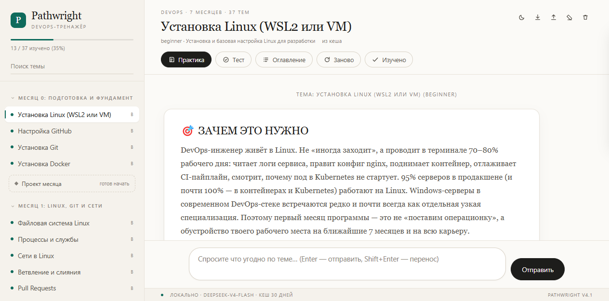
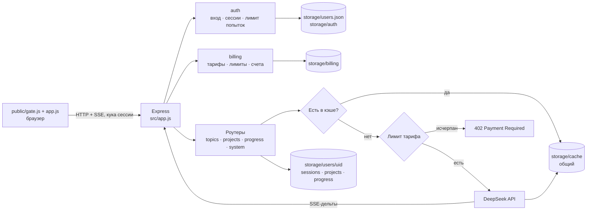

# Pathwright

**Сервис подготовки к DevOps с ИИ-наставником.** Роадмап на 7 месяцев, полноценные уроки, практические воркшопы, тесты и итоговые проекты. Аккаунты, подписки, пробный период и лимиты генераций — всё внутри, без внешних баз данных.

[](https://nodejs.org)
[](LICENSE)
[](https://github.com/Qatrol/pathwright/actions/workflows/ci.yml)




---

## Что это

Учить DevOps по разрозненным статьям тяжело: непонятно, что учить следующим, как проверить, что понял, и где остановился. Pathwright даёт структуру: 37 тем от установки Linux до подготовки к собеседованию. На каждую тему наставник пишет большой урок, даёт практическое задание и проводит тест.

Приложение выросло из личного тренажёра в сервис: регистрация, вход по сессии, пробный период, тарифы с лимитами и личный кабинет. У каждого пользователя свои прогресс, сессии и проекты; кэш уроков общий, поэтому повторный просмотр не тратит токены ни у него, ни у вас.

## Возможности

- **Аккаунты** — регистрация по email и паролю с капчей, серверные сессии в HttpOnly-куке
- **Пробный период** — 7 дней полного доступа сразу после регистрации, без карты
- **Тарифы и лимиты** — Free / Basic / Pro с дневным и месячным потолком генераций
- **Оплата по СБП** — через ЮKassa, если заданы ключи; без ключей — тестовая заглушка
- **Настройки** — профиль, безопасность, активные сессии, подписка и счета в одном окне
- **Аккаунт в сайдбаре** — слева снизу: имя, тариф, переход в настройки по клику
- **Роадмап на 7 месяцев** — 37 тем по порядку, прогресс в процентах, поиск и сворачиваемые месяцы
- **Три режима на тему** — урок, практический воркшоп, тест с вопросами с собеседований
- **ИИ-наставник с контекстом** — помнит историю диалога по теме, знает, что вы уже прошли, и объясняет с нужного уровня
- **Проект месяца** — итоговая практика по изученным темам, шаг за шагом, без готовых решений
- **Стриминг** — текст появляется по мере генерации; если модель обрезалась по лимиту, сервер дописывает ответ
- **Кэш на 30 дней** — повторный просмотр урока не тратит ни токены, ни лимит
- **Сессии на 90 дней** — можно вернуться к любой теме и продолжить диалог
- **Экспорт и импорт** — прогресс и проекты в JSON, урок и проект в Markdown
- **Светлая и тёмная тема**, адаптивная вёрстка, горячие клавиши

## Тарифы

Лимиты считаются в генерациях — новых ответах модели. Готовые уроки из кэша открываются всем без ограничений.

| Тариф | Цена | В день | В месяц | Когда |
|---|---|---|---|---|
| Пробный | 0 ₽ | 60 | 400 | 7 дней после регистрации |
| Free | 0 ₽ | 5 | 100 | после пробного периода |
| Basic | 390 ₽/мес | 40 | 900 | подписка |
| Pro | 790 ₽/мес | 150 | 4000 | подписка |

Периоды оплаты: 1 месяц, 3 месяца (−10%), 12 месяцев (−20%). Цены и лимиты меняются в [`src/billing/plans.js`](src/billing/plans.js).

**Оплата.** Если заданы `YOOKASSA_SHOP_ID` и `YOOKASSA_SECRET_KEY`, счёт уходит в ЮKassa способом СБП: клиент попадает на страницу выбора банка, а подписку активирует вебхук `/api/billing/webhook/yookassa`. Тело уведомления не считается доверенным — статус платежа перепроверяется запросом к API ЮKassa.

В личном кабинете ЮKassa укажите вебхук `https://<ваш-домен>/api/billing/webhook/yookassa` на событие `payment.succeeded` — без него подписка не активируется.

Без ключей работает тестовая заглушка: счёт создаётся, в настройках появляется кнопка «Оплатить (тест)», подписка активируется сразу, деньги не списываются. Это режим для разработки, на публичном инстансе его нужно выключать (`PAYMENT_STUB=false` или задать ключи).

## Скриншоты

| Светлая тема | Тёмная тема |
|---|---|
|  |  |

## Быстрый старт

Нужен Node.js 18+ и ключ [DeepSeek API](https://platform.deepseek.com/api_keys).

```bash
git clone https://github.com/Qatrol/pathwright.git
cd pathwright
npm install
cp .env.example .env
# откройте .env и вставьте DEEPSEEK_API_KEY
npm start
```

Откройте [http://localhost:5555](http://localhost:5555) и зарегистрируйте аккаунт. Первый зарегистрированный пользователь получает роль `admin`: ему доступны очистка кэша и отчёт по токенам.

На Windows можно запустить `start.bat` — он проверит Node.js, `.env`, зависимости и откроет браузер.

### Docker

```bash
cp .env.example .env   # вставьте ключ
docker compose up -d --build
```

Приложение будет на `http://localhost:5555`, данные — в `./storage` на хосте. В контейнере `HOST=0.0.0.0`, снаружи порт публикуется только через compose.

### Переменные окружения

| Переменная | Обязательна | По умолчанию | Описание |
|---|---|---|---|
| `DEEPSEEK_API_KEY` | да | — | ключ DeepSeek, один на сервер |
| `PORT` | нет | `5555` | порт сервера |
| `HOST` | нет | `127.0.0.1` | интерфейс; `0.0.0.0` — для Docker или доступа из сети |
| `STORAGE_DIR` | нет | `./storage` | каталог данных (кэш, аккаунты, сессии, счета, логи) |
| `TRIAL_DAYS` | нет | `7` | длина пробного периода, `0` — выключить |
| `REGISTRATION_OPEN` | нет | `true` | `false` закрывает регистрацию |
| `REGISTRATION_LIMIT` | нет | `5` | сколько аккаунтов в час можно создать с одного адреса |
| `ADMIN_EMAILS` | нет | — | email'ы через запятую, которым даётся роль admin |
| `TIMEZONE` | нет | `Europe/Moscow` | часовой пояс, в котором сбрасывается дневной лимит |
| `COOKIE_SECURE` | нет | `false` | `true` за HTTPS: кука уходит только по TLS |
| `TRUST_PROXY` | нет | `false` | `true` за reverse-proxy: доверять `X-Forwarded-*` |
| `PAYMENT_STUB` | нет | `true` | `false` отключает тестовую оплату |
| `YOOKASSA_SHOP_ID` | нет | — | shopId ЮKassa; вместе с секретом включает оплату по СБП |
| `YOOKASSA_SECRET_KEY` | нет | — | секретный ключ ЮKassa |
| `PUBLIC_BASE_URL` | нет | — | адрес сайта для возврата с оплаты |
| `DEEPSEEK_MODEL` | нет | `deepseek-v4-flash` | модель |
| `STUDENT_PROFILE` | нет | профиль автора | описание уровня ученика, влияет на стиль объяснений |

## Как это работает



1. Браузер загружает `gate.js`. Он спрашивает `/api/auth/me`; без сессии показывает экран входа, с сессией — подгружает `app.js`.
2. При открытии темы сервер проверяет кэш. Если ответ есть и моложе 30 дней — отдаёт его сразу, бесплатно и без проверки лимита.
3. Иначе считается лимит тарифа. Исчерпан — `402` с причиной и временем сброса. Есть запас — генерация списывается, собирается промпт и уходит в DeepSeek.
4. Дельты летят в браузер через SSE и сразу рендерятся. Ответ сохраняется в кэш и в сессию пользователя.
5. Если модель остановилась по лимиту токенов, сервер автоматически просит продолжение (до двух раз). Если запрос упал до ответа, списанная генерация возвращается.

## Структура проекта

```
pathwright/
├─ server.js                 # точка входа: listen, очистка, graceful shutdown
├─ src/
│  ├─ app.js                 # Express: заголовки, статика, подключение роутеров
│  ├─ config.js              # конфиг из .env, тарифные константы, пути storage
│  ├─ roadmap.js             # программа: 7 месяцев, 37 тем
│  ├─ progress.js            # личный прогресс по темам и контекст месяца
│  ├─ prompts.js             # роли наставника и промпты (урок/практика/тест/проект)
│  ├─ llm.js                 # DeepSeek: стриминг, ретраи, автопродолжение, лог токенов
│  ├─ auth/                  # пароли, пользователи, сессии, капча, middleware
│  ├─ billing/               # тарифы, лимиты, счета, ЮKassa, guard генерации
│  ├─ lib/                   # fs-json, id-валидация, in-flight, обрезка истории
│  ├─ storage/               # кэш, сессии, проекты, пути пользователя
│  └─ routes/                # auth, billing, system, progress, topics, projects
├─ public/
│  ├─ index.html             # разметка: приложение + экран входа + кабинет
│  ├─ styles.css             # редакционная тема, светлая и тёмная
│  ├─ gate.js                # вход, капча, аккаунт в сайдбаре
│  ├─ settings.js            # настройки: профиль, безопасность, подписка, счета
│  ├─ app.js                 # роадмап, SSE, markdown, прогресс, проекты
│  └─ favicon.svg
├─ tests/                    # node:test — API, авторизация, биллинг, утилиты
├─ scripts/check.js          # синтаксическая проверка всех JS-файлов
├─ docs/                     # скриншоты и архитектура
├─ Dockerfile · docker-compose.yml · .dockerignore
├─ .github/workflows/ci.yml  # syntax check + tests + smoke test
└─ storage/                  # создаётся автоматически, в .gitignore
   ├─ users.json             # аккаунты (хэши паролей scrypt)
   ├─ users/<uid>/           # sessions/, projects/, progress.json
   ├─ auth/sessions.json     # хэши токенов сессий
   ├─ billing/               # счета и расход генераций по пользователям
   ├─ cache/                 # ответы модели (TTL 30 дней, общие для всех)
   ├─ logs/                  # расход токенов по дням
   └─ progress.json          # старый формат, больше не используется
```

## API

| Метод | Путь | Доступ | Назначение |
|---|---|---|---|
| `GET` | `/health` | публично | статус, версия, размеры кэшей |
| `GET` | `/api/roadmap` | публично | программа курса |
| `GET` | `/api/auth/captcha` | публично | пример для проверки человека |
| `POST` | `/api/auth/register` | публично | регистрация, старт пробного периода |
| `POST` | `/api/auth/login` | публично | вход, выдача сессии |
| `POST` | `/api/auth/logout` | сессия | выход |
| `GET` | `/api/auth/me` | сессия | пользователь, тариф, расход |
| `POST` | `/api/auth/profile` | сессия | имя; email — с текущим паролем |
| `GET` | `/api/auth/sessions` | сессия | активные сессии аккаунта |
| `POST` | `/api/auth/sessions/revoke` | сессия | завершить сессию или все чужие |
| `POST` | `/api/auth/password` | сессия | смена пароля |
| `GET` | `/api/billing/plans` | публично | каталог тарифов и периодов |
| `GET` | `/api/billing/status` | сессия | тариф, лимиты, расход |
| `POST` | `/api/billing/checkout` | сессия | создать счёт |
| `POST` | `/api/billing/invoices/:id/pay` | сессия | подтвердить оплату (только заглушка) |
| `POST` | `/api/billing/webhook/yookassa` | провайдер | уведомление об оплате СБП |
| `GET` | `/api/billing/invoices` | сессия | счета пользователя |
| `POST` | `/api/billing/cancel` | сессия | отменить/возобновить автопродление |
| `GET` | `/api/stats` | сессия | прогресс, процент, кэш, оценка токенов |
| `GET/POST` | `/api/progress` | сессия | чтение и слияние прогресса |
| `GET` | `/api/cache/:topicId/:type` | сессия | проверка кэша |
| `GET` | `/api/history/:sessionId` | сессия | текущая тема и число тем в сессии |
| `POST` | `/api/explain` | сессия + лимит | урок по теме (SSE) |
| `POST` | `/api/task` | сессия + лимит | практический воркшоп (SSE) |
| `POST` | `/api/quiz` | сессия + лимит | тест (SSE) |
| `POST` | `/api/ask` | сессия + лимит | вопрос по текущей теме (SSE) |
| `POST` | `/api/reset-topic` | сессия | сбросить историю темы |
| `POST` | `/api/delete-topic` | сессия | удалить тему из кэша и сессии |
| `GET` | `/api/project/:monthId` | сессия | состояние проекта месяца |
| `POST` | `/api/project/start` | сессия + лимит | сгенерировать план проекта (SSE) |
| `POST` | `/api/project/ask` | сессия + лимит | шаг проекта (SSE) |
| `POST` | `/api/project/reset` | сессия | сбросить проект |
| `GET` | `/api/project/:monthId/export` | сессия | проект в Markdown |
| `POST` | `/api/project/import` | сессия | импорт проектов |
| `GET` | `/api/export` | сессия | полный бэкап данных пользователя |
| `POST` | `/api/clean-cache` | admin | очистить общий кэш |
| `GET` | `/api/tokens-report` | admin | расход и оценка стоимости токенов |

SSE-события: `delta` (текст), `cached` (ответ из кэша), `continuation` (номер автопродолжения), `usage` (токены), `warning` (ответ обрезан), `done`, `error`.

Ошибки API: `401 UNAUTHORIZED`, `402 LIMIT_REACHED` (с полями `scope`, `limit`, `used`, `resetAt`), `403 FORBIDDEN`, `409 EMAIL_TAKEN`, `429 TOO_MANY_ATTEMPTS`.

## Как устроен ИИ

- **Промпт из слоёв.** Системная защита от подмены роли → роль наставника и профиль ученика → вся программа → личный прогресс → тема и задача. Модель видит, что ученик уже прошёл, и не объясняет Kubernetes человеку, который ещё не поставил Docker.
- **Стриминг + автопродолжение.** Ответ идёт через SSE. Если `finish_reason = length`, сервер добавляет последний фрагмент и просит продолжить — до двух раз. Если и после этого обрезано, в браузер уходит предупреждение.
- **Кэш по теме и типу.** Ключ — `topicId + тип + версия кэша`. Версия (`v4`) позволяет разом инвалидировать старые ответы при смене промптов. TTL — 30 дней, старые файлы чистит фоновый таймер.
- **Дедупликация.** Пока один и тот же урок генерируется, повторный запрос ждёт тот же промис, а не запускает второй вызов.
- **Ретраи.** Сетевые ошибки, `429` и `5xx` повторяются до трёх раз с паузой; `400/401/403` не повторяются. Повтор возможен только до отправки первого байта клиенту.
- **Heartbeat.** Комментарий `: ping` каждые 15 секунд не даёт прокси прибить соединение, пока модель думает.
- **Лимиты.** 20 генераций в минуту с адреса — грубая сетка от циклов. Точный потолок по тарифу (день и месяц) считает `src/billing/guard.js`; списание возвращается, если модель упала.
- **Экономия контекста.** История вопроса обрезается по 50 сообщениям и 24 000 символов, история проекта — по 48 000.
- **Лог токенов.** Каждый вызов пишет день, эндпоинт, prompt/completion и попадания в кэш DeepSeek в `storage/logs/tokens-YYYY-MM-DD.log`; `/api/tokens-report` считает оценку стоимости.

Подробности — в [docs/ARCHITECTURE.md](docs/ARCHITECTURE.md).

## Безопасность

- Пароли — `scrypt` из стандартной библиотеки Node с солью и `timingSafeEqual`. Хэш пароля наружу не отдаётся.
- В куке лежит случайный токен, на диске — только его SHA-256. Кука `HttpOnly`, `SameSite=Lax`, за HTTPS включается `Secure` (`COOKIE_SECURE=true`).
- Смена пароля закрывает все сессии аккаунта и выдаёт новую текущей вкладке.
- CSRF: `SameSite=Lax` плюс явная сверка `Origin` у всех POST/PUT/PATCH/DELETE.
- Вход ограничен: 10 попыток на пару адрес+email и 100 на адрес за 15 минут; после трёх неудач требуется капча (одноразовый арифметический пример). Регистрация всегда с капчей и лимитом 5 аккаунтов в час с адреса. Ответ на неверный пароль и несуществующий email одинаковый, включая время ответа.
- В настройках видно все активные сессии; любую можно завершить, есть «выйти везде».
- Вебхук ЮKassa не доверяет телу уведомления: статус платежа перепроверяется запросом к API, метаданные связывают платёж со счётом и аккаунтом.
- Каждый пользователь получает свой каталог `storage/users/<uid>`: сессии, проекты и прогресс не пересекаются. Чужие счета и сессии по id недоступны.
- Идентификаторы сессий, тем, пользователей и номер месяца валидируются до попадания в путь файла — обход каталогов закрыт.
- Ключ DeepSeek живёт только в `.env` (в git не попадает) и никогда не уходит в браузер. `storage/` тоже в `.gitignore`.
- CORS выключен, включены CSP, `X-Frame-Options: DENY`, `nosniff`, `no-referrer`, `Permissions-Policy`.
- Markdown из ответов модели экранируется перед вставкой в DOM; в личном кабинете данные экранируются при сборке разметки.
- Сервер по умолчанию слушает `127.0.0.1`. Для публичного запуска нужен reverse-proxy с TLS, `COOKIE_SECURE=true` и `TRUST_PROXY=true`.

## Тесты и CI

```bash
npm run check   # синтаксис всех JS-файлов
npm test        # API, авторизация, биллинг, утилиты — без вызовов DeepSeek
```

GitHub Actions на каждый push и pull request запускает оба шага и smoke-тест: поднимает сервер без ключа и проверяет `/health`, роадмап, статику и `401` на закрытых ручках.

## Разработка

```bash
npm run dev     # node --watch server.js
```

- Новая тема — объект в `src/roadmap.js`; тип и кэш подхватятся автоматически.
- Изменение стиля объяснений — `src/prompts.js`; после правок поднимите `CACHE_VERSION` в `src/config.js`, иначе старые ответы останутся в кэше.
- Тарифы, цены и лимиты — `src/billing/plans.js`.
- Новый эндпоинт — роутер в `src/routes/` и подключение в `src/app.js`. Не забудьте `requireAuth`: без него ручка окажется открытой.
- Интерфейс — `public/`; сборки нет, файлы отдаются как есть.

## Дорожная карта

- [ ] Реальный платёжный провайдер (ЮKassa) и вебхук подтверждения
- [ ] Восстановление пароля по email
- [ ] Подтверждение email при регистрации
- [ ] Экспорт всего курса в один Markdown-файл
- [ ] Локальные модели через Ollama
- [ ] Интервальное повторение тестов
- [ ] UI-панель расхода токенов для администратора

## Лицензия

[MIT](LICENSE) — берите и пользуйтесь.

---

## English

Pathwright is a self-hosted DevOps learning service with an AI tutor. It ships a 7-month, 37-topic roadmap, writes full lessons, hands-on workshops, quizzes and month projects, and caches answers locally in JSON files. Node.js + Express + DeepSeek, no database, no build step.

Accounts are email + password with server-side sessions. Every registration starts a 7-day trial; after it the account falls back to a free tier with a small daily generation limit. Paid plans (Basic, Pro) are provisioned through a pluggable provider — the bundled one is a stub that creates an invoice and lets you confirm it from the dashboard, so the billing flow can be tested end to end without a merchant account.

Run `npm install && npm start` after adding `DEEPSEEK_API_KEY` to `.env`. Default bind is `127.0.0.1`; use Docker Compose or set `HOST=0.0.0.0` behind a TLS proxy with `COOKIE_SECURE=true`.
