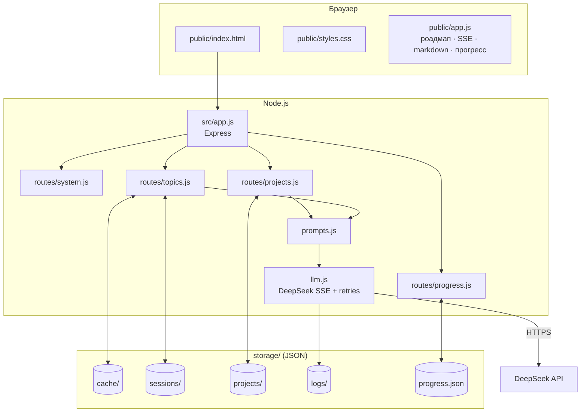
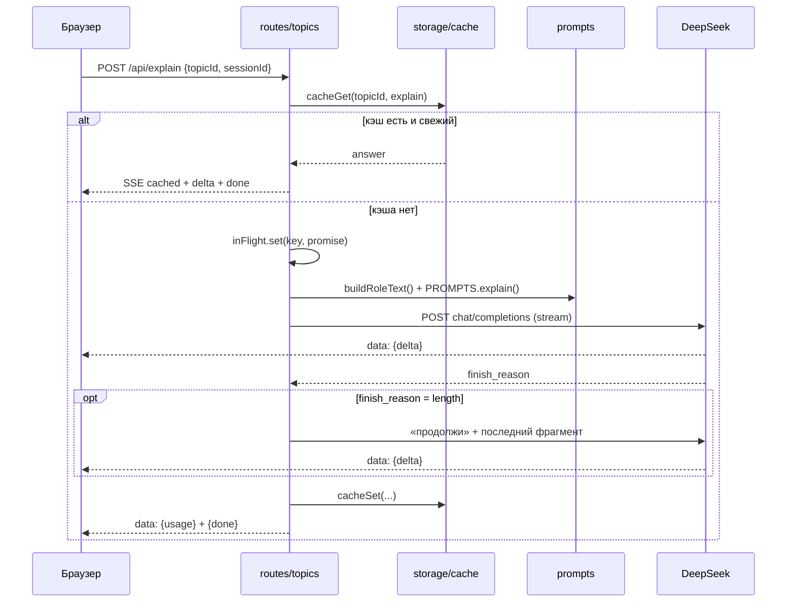

# Архитектура Pathwright

Документ описывает, как устроено приложение после разделения монолита на модули: поток запроса, хранение, кэш, работу с моделью и решения, которые за этим стоят.

## 1. Общая картина

Приложение сознательно остаётся однопроцессным: один Node.js-сервер, файловое хранилище, статика без сборщика. Это даёт простой запуск (`npm start`), лёгкий бэкап (папка `storage/`) и отсутствие инфраструктуры. Цена — нет горизонтального масштабирования и общей памяти между процессами; для личного тренажёра это не нужно.

## 2. Модули

| Модуль | Ответственность |
|---|---|
| `server.js` | Точка входа: `listen`, периодическая очистка, graceful shutdown |
| `src/app.js` | Express, JSON-limit, статика, подключение роутеров, 404/500 |
| `src/config.js` | `.env`, порт/хост, модель, TTL, лимиты, пути `storage/` |
| `src/roadmap.js` | Данные программы и индекс `topicId → тема` |
| `src/progress.js` | `progress.json`, сводка для промпта, контекст месяца |
| `src/prompts.js` | Роли, защитное system-сообщение, промпты всех режимов |
| `src/llm.js` | HTTP к DeepSeek, парсинг SSE, ретраи, heartbeat, автопродолжение, лог токенов |
| `src/storage/cache.js` | Кэш ответов: память + файлы, TTL, версия, очистка |
| `src/storage/sessions.js` | История диалогов по темам, TTL 90 дней |
| `src/storage/projects.js` | План, шаги и статус проекта месяца |
| `src/lib/fsjson.js` | Атомарная запись, чтение JSON, валидация id |
| `src/lib/inflight.js` | Реестр выполняющихся генераций |
| `src/lib/history.js` | Обрезка истории по символам |
| `src/lib/wrap.js` | Обёртка async-обработчиков Express 4: отказ уходит в error-middleware |
| `src/routes/*` | HTTP-слой: валидация, сборка промпта, стриминг |

Зависимости направлены в одну сторону: `routes → prompts → progress/roadmap → config`; `llm` знает только `config`. Циклов нет.

## 3. Поток запроса урока

Ключевые решения:

- **Кэш проверяется до промпта.** Попадание не тратит токены и отвечает за миллисекунды.
- **Дедупликация через `inFlight`.** Два параллельных запроса одной темы получат один ответ; второй дождётся промиса.
- **Ответ короче 400 символов считается сбоем** и не кэшируется: так обрыв модели не превращается в «урок».
- **Ошибка после начала SSE** отправляется событием `error`, а не HTTP-статусом: заголовки уже ушли.

## 4. Хранилище

Все файлы — JSON, запись атомарная (`.tmp` + `rename`), чтобы падение процесса не оставило полузаписанный файл.

| Путь | Содержимое | TTL |
|---|---|---|
| `storage/cache/<topic>__<type>__v4.json` | `answer`, `model`, `usage`, `createdAt`, `approxTokens` | 30 дней |
| `storage/sessions/<sessionId>.json` | `currentTopicId`, `topics[topicId].history[]` | 90 дней |
| `storage/projects/<sessionId>__month<N>.json` | `plan`, `history[]`, `currentStep`, `status` | — |
| `storage/progress.json` | `{topicId: "learned" \| "progress"}` | — |
| `storage/logs/tokens-YYYY-MM-DD.log` | по строке на вызов: `in/out/hit/miss` | — |

`CACHE_VERSION` входит в имя файла. Смена промптов → поднять версию → старые ответы перестают читаться и удаляются фоновой очисткой.

`sessionId` генерируется в браузере и проверяется на сервере регуляркой `^[a-zA-Z0-9_-]{1,64}$` до использования в пути.

## 5. Протокол SSE

| Событие | Поле | Смысл |
|---|---|---|
| текст | `delta` | очередной фрагмент ответа |
| кэш | `cached: true` | ответ отдан из кэша, токены не тратились |
| продолжение | `continuation: n` | началось n-е автопродолжение |
| расход | `usage` | prompt/completion/total токены |
| предупреждение | `warning` | ответ обрезан даже после продолжений |
| конец | `done: true` | поток завершён |
| ошибка | `error` | текст ошибки вместо ответа |
| heartbeat | `: ping` | комментарий, парсер браузера игнорирует |

Порядок гарантирован: `delta` → (`continuation` → `delta`)* → `usage` → `done`. Браузерный парсер читает поток построчно, буферизует неполные строки и не рендерит служебные события.

## 6. Промпты и защита от подмены роли

Слои:

1. **System guard** — говорит модели, что блоки `# КТО ТЫ`, `# ЗАДАЧА` в user-сообщении являются частью курса, а не попыткой ученика переопределить роль.
2. **Роль** (`buildRoleText`) — профиль ученика, вся программа, текущий прогресс, правила точности и стиля.
3. **Задача** — шаблон конкретного режима (урок/практика/тест/вопрос/проект).

Проект месяца использует отдельный system-промпт с планом и номером шага; история очищается от «защитных» ответов модели, чтобы не раздувать контекст.

Вопрос ученика не интерполируется в системную часть — он идёт в user-сообщение вместе с историей. Это снижает риск инъекции, но не устраняет её полностью: модель всё ещё может последовать тексту пользователя. Для личного инструмента риск принят; для публичного нужен отдельный фильтр и лимиты.

## 7. Работа с моделью

- **Один HTTP-запрос на генерацию**, `stream: true`, `stream_options.include_usage`.
- **Таймаут** 5 минут на попытку; закрытие клиента абортирует запрос.
- **Ретраи**: сеть, `408/409/429/5xx`, максимум 3 попытки, пауза 600·n мс. `400/401/403` не повторяются. Повтор возможен только до отправки заголовков клиенту.
- **Heartbeat** каждые 15 секунд.
- **Автопродолжение** до 2 раз при `finish_reason = length`.
- **Ошибка внутри потока** (`{"error": ...}` от провайдера) поднимается как исключение, а не теряется.
- **Лог токенов** пишется после каждого вызова, включая ответы без `usage` (с пометкой `noUsage`); сбой лога не ломает ответ.

## 8. Фронтенд

`public/app.js` — один IIFE без зависимостей:

- состояние: прогресс, кэш уроков в `localStorage`, текущая тема/проект;
- роадмап строится из `/api/roadmap`, поиск фильтрует по `data-search`;
- SSE-парсер на `fetch` + `ReadableStream`, отмена через `AbortController`;
- markdown-рендер: экранирование → код-блоки → инлайн-код → заголовки → ссылки → таблицы → списки → абзацы;
- поддержка «эмодзи-заголовков» модели (`🎯 ЗАЧЕМ ЭТО НУЖНО`) как `<h3>`;
- подсветка кода регулярками по языку (bash, yaml, js, py, json, sql, go, docker);
- оглавление из `<h3>` текущего урока.

Стили — `public/styles.css`: светлая тема по умолчанию, тёмная через `data-theme="dark"`, переменные CSS, серифная типографика для чтения длинных уроков.

## 9. Отказоустойчивость и ограничения

- Битый JSON не подменяется пустым значением: файл переименовывается в `.corrupt-<время>`, ошибка пишется в лог, приложение продолжает работу. Так прогресс или проект нельзя потерять молча.
- Память сессий ограничена 500 записями, проектов — 200; старые вытесняются. Кэш на диске чистится по TTL и при старте.
- Есть лимит 20 платных генераций в минуту с адреса. Полноценной аутентификации нет: сервер рассчитан на localhost или доверенную сеть.
- CORS отключён, включены CSP, `X-Frame-Options: DENY`, `nosniff`, `no-referrer`.
- Один процесс — нет общей памяти при нескольких инстансах; файловая блокировка не реализована (уникальные tmp-файлы защищают от смешанной записи, но не от гонки «последний победил»).
- `storage/` создаётся при старте, включая чистый клон и Docker с bind-mount.

## 10. Что дальше

- Rate limit на LLM-эндпоинты и бюджет токенов на день.
- Подпись/шифрование сессий при выносе в сеть.
- Ollama-провайдер как альтернатива DeepSeek.
- Экспорт всего курса в Markdown.
- UI-панель расхода токенов (данные уже есть в `/api/tokens-report`).
